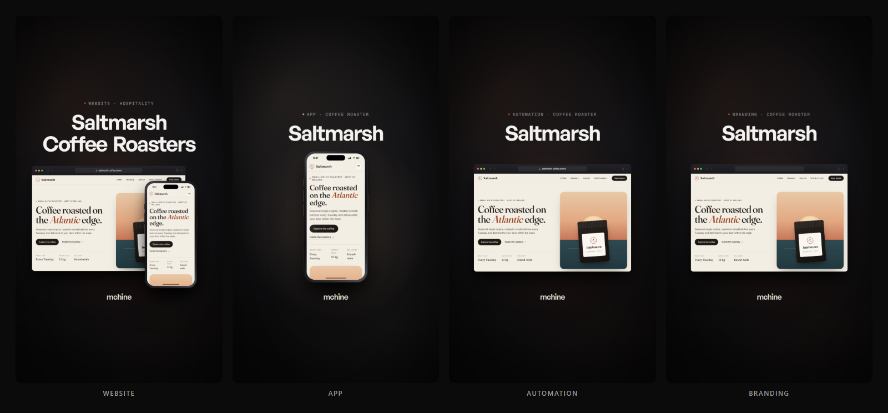
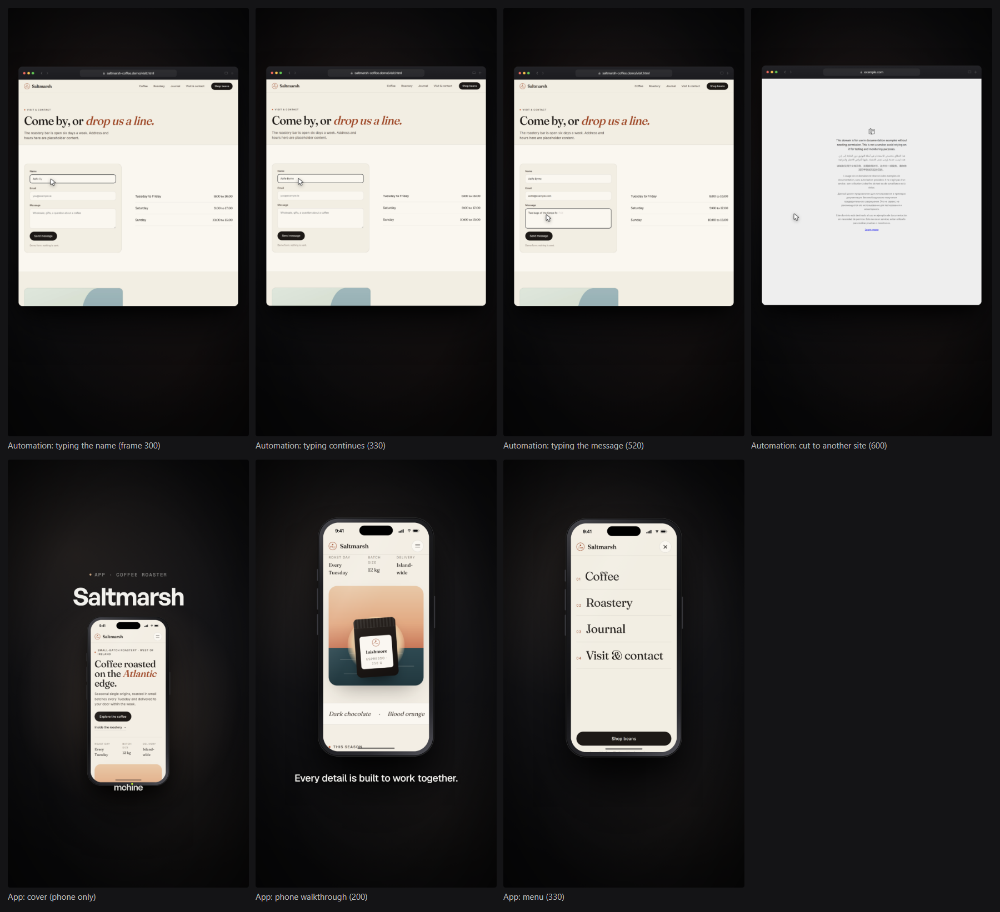
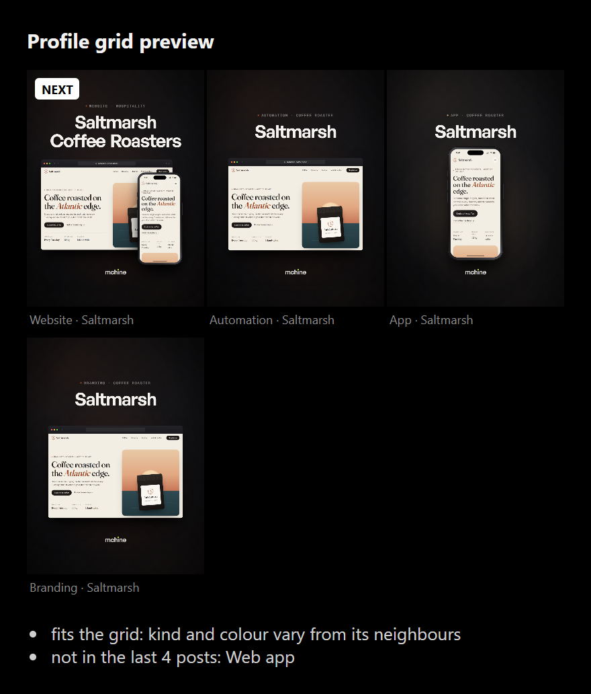

<p align="center">
  
</p>

<h1 align="center">Claude Showcase Kit</h1>

<p align="center">
  <b>A Claude Code skill that turns your real work into cinematic Instagram Reels.</b><br />
  Websites, web apps, apps, automations and brand identities, recorded for real, narrated, scored and
  cut into a 25-second Reel with a matching cover, all in one consistent portfolio style.
</p>

<p align="center"><code>/showcase</code></p>

---

## What it does

Open Claude Code in the repository of something you built and type `/showcase`. Claude:

1. **Asks how you want to present the Reel** and helps plan what to show. Choose voice-over or a
   presenter on camera. For a presenter, Claude writes a talking-head prompt for you to record or
   generate, then waits for the footage.
2. **Records the real thing** with Playwright. Real scrolling, menus, clicks, typing and page changes
   on desktop and mobile. For automations, the trigger, the run and the result in every app it
   touches, joined by cuts.
3. **Syncs the narration** to the actions it describes. Voice-over mode uses a local British English
   voice. Presenter mode uses the voice from your take throughout, with presenter cards at the
   beginning and end.
4. **Renders the Reel** (1080×1920, H.264) with Remotion. The cover lockup, walkthrough and studio
   outro share the same style. The edit includes subtitles, a ducked music bed and subtle sound design.
5. **Exports the Instagram cover** (`instagram-cover.png`), the exact opening frame of the video,
   with a preview of how it crops in the profile grid.
6. **Checks your profile**: it previews the grid with the new post first and warns if it breaks the
   portfolio's rhythm.
7. **Runs QA** on the result: format, frames, freezes, narration timing, voice above music on rendered
   stems, loudness, and the cover matching the video.

The walkthrough uses real pages, screens and interactions from your project. The engine reads your
repository and keeps its outputs in the showcase project folder.

## One idea for every kind of work

| Kind | The walkthrough | Shown on |
|---|---|---|
| **Website** | Home, a strong section, the menu, a service page, projects, the mobile menu, contact | Desktop + mobile |
| **Web app** | The dashboard, a record, one real action and its result | Desktop + mobile |
| **App** | The main flow on a phone, one real action | Mobile |
| **Automation** | The trigger, the workflow running, the result in each app, joined by cuts | Desktop |
| **Branding** | The brand guidelines or brand site: logo, palette, type, applications | Desktop |

<p align="center">
  
</p>

## A profile that reads as one portfolio

Every post shares the same stage, devices, typography, pacing, voice, music, cover layout and
signature; only the work changes. The cover carries a fixed taxonomy (`Website · Restaurant`,
`Automation · Lead follow-up`), and `showcase grid` previews the profile with the next post first. It
warns about three posts of the same kind in a row, near-identical colours side by side, or a title too
long for a thumbnail.

<p align="center">
  
</p>

Your studio's identity (name, logo, accent colour, typefaces) is set once in `agency.config.json`
and used on every cover and outro.

## Install

You need [Claude Code](https://claude.com/claude-code), **Node.js 20.19+**, and **Google Chrome**
(or Edge).

```bash
git clone https://github.com/mchine-ltda/claude-showcase-kit.git
```

```bash
cd claude-showcase-kit && ./install.sh
```

On Windows use `.\install.ps1` in PowerShell. The installer:
1. installs the dependencies;
2. creates `agency.config.json` for your studio;
3. installs the skill into `~/.claude/skills/showcase`, so it is available in every project.

Start a new Claude Code session anywhere and type `/showcase`.

Try it on the bundled demo first:

```bash
npm run demo
```

This renders a fictional coffee roaster's website end to end.

## Use

In any repository:

> /showcase https://murphysbakery.ie

or just ask: *"make an Instagram reel of this automation"*.

You can also drive the engine yourself. The skill's launcher works from any directory:

```bash
node ~/.claude/skills/showcase/scripts/showcase.mjs init murphys --kind website --url https://murphysbakery.ie --name "Murphy's Bakery" --category Bakery
node ~/.claude/skills/showcase/scripts/showcase.mjs capture murphys
node ~/.claude/skills/showcase/scripts/showcase.mjs narrate murphys
node ~/.claude/skills/showcase/scripts/showcase.mjs render murphys
node ~/.claude/skills/showcase/scripts/showcase.mjs grid murphys
```

For web apps and automations, `showcase login <project> --url <app>` opens Chrome. You sign in with
a demo account yourself, and the session is reused for the recording.

## Documentation

| | |
|---|---|
| [SKILL.md](skills/showcase/SKILL.md) | What Claude does when you type `/showcase`, including the interview |
| [WORKFLOW.md](skills/showcase/WORKFLOW.md) | The full process per kind of work |
| [PRESENTER.md](skills/showcase/PRESENTER.md) | Recording prompt, footage review and presenter setup |
| [STYLE-GUIDE.md](skills/showcase/STYLE-GUIDE.md) | The visual, pacing, narration, audio, cover and profile rules |
| [CONFIG-EXAMPLE.md](skills/showcase/CONFIG-EXAMPLE.md) | Annotated website and automation configs |
| [FRAMEWORK.md](skills/showcase/FRAMEWORK.md) | Architecture and render pipeline |
| [INSTALLATION.md](skills/showcase/INSTALLATION.md) | Install, update, voices, privacy, licensing, troubleshooting |
| [docs/](docs/) | Engine reference: configuration, capture, narration, audio, templates |

## Privacy

Your projects (captures of client work, narration, renders, saved logins), your agency kit and any
`.env` are git-ignored. Only the fictional demo is in this repository. Use demo accounts and demo
data for anything behind a login, and blur what cannot be avoided (`capture.blur`).

## Credits and licence

Code and docs: [MIT](LICENSE), by [MCHINE](https://github.com/mchine-ltda), a web design and
engineering studio in Dublin. Built on [Remotion](https://www.remotion.dev) (its own licence: free for
individuals and small companies), [Playwright](https://playwright.dev) and
[Kokoro](https://huggingface.co/hexgrad/Kokoro-82M). See [THIRD_PARTY_NOTICES.md](THIRD_PARTY_NOTICES.md).
Sibling project: [Claude Brand Kit](https://github.com/mchine-ltda/claude-brand-kit).
